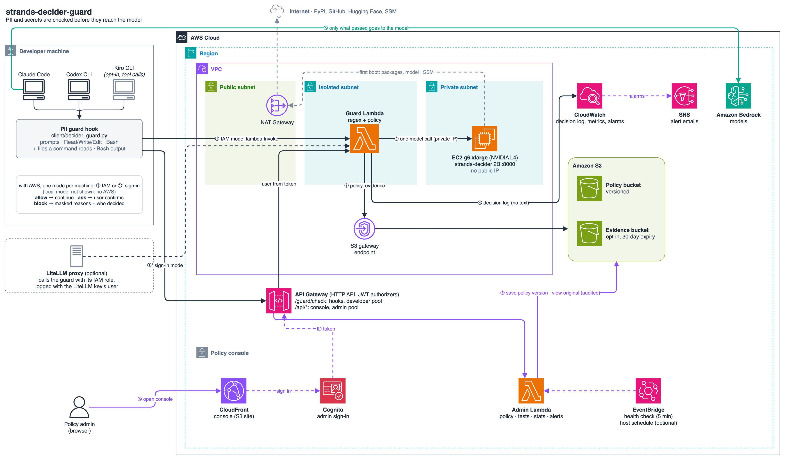

# strands-decider-guard

[](https://github.com/ltrain81/strands-decider-guard/actions/workflows/ci.yml)

**고객 PII와 비밀 값이 모델에 닿기 전에 막습니다.** 작고 빠른 판단 모델
[strands-decider](https://github.com/strands-labs/strands-decider)를 **Claude Code**, **Codex CLI** 앞단에 둡니다.
원하면 **LiteLLM** 프록시 안에도 둘 수 있습니다. Kiro CLI 는 선택 사항이며 도구 호출만 막을 수 있습니다.

- 프롬프트, 파일 읽기, 편집, 셸 명령을 수백 ms 안에 검사합니다.
- 민감하면 차단하거나 사용자에게 확인을 받습니다.
- 무엇이 민감한지는 관리자가 웹 콘솔에서 정합니다. 대부분의 규칙은 문장으로 쓴 질문이라 정규식을 몰라도 됩니다.

[English README](README.md)

```text
> 고객 주민등록번호 900101-1234567 로 가입 이력 조회하는 SQL 짜줘

UserPromptSubmit operation blocked by hook:
[PII guard] 민감 정보가 감지되어 차단했습니다 (프롬프트).
  - [prompt] 주민등록번호 패턴 감지 (900********567)
  마스킹하거나 해당 데이터를 제외하고 다시 시도하세요.
```

## 목차

- [동작 방식](#동작-방식)
- [경로 고르기](#경로-고르기)
- [빠른 시작: 로컬 (AWS 없이)](#빠른-시작-로컬-aws-없이)
- [빠른 시작: 팀용 AWS 배포](#빠른-시작-팀용-aws-배포)
- [에이전트별 검사 범위](#에이전트별-검사-범위)
- [정책 관리](#정책-관리)
- [운영과 비용](#운영과-비용)
- [정확도와 지연시간](#정확도와-지연시간)
- [한계](#한계)
- [문제 해결](#문제-해결)
- [저장소 구조](#저장소-구조)
- [개발](#개발)

더 보기:
- [설정 레퍼런스 (영문)](docs/CONFIGURATION.md)
- [정책 콘솔 가이드](docs/ADMIN.ko.md)
- [LiteLLM](docs/LITELLM.ko.md)
- [데모 영상 촬영](docs/DEMO_VIDEO.ko.md)

## 동작 방식



1. hook 이 프롬프트, 또는 도구 입력과 그 도구가 다루는 파일을 guard Lambda 로 보냅니다 (`lambda:Invoke`, IAM 인증).
2. guard 는 정규식을 먼저 보고, GPU 호스트의 strands-decider 를 private IP 로 **한 번** 호출합니다.
3. S3 게이트웨이 엔드포인트로 읽은 현재 정책을 적용합니다 (30초 캐시).
4. 판정, 유형, 크기만 로그로 남기고 원문은 남기지 않습니다.
5. 통과한 것만 모델로 갑니다.

관리자는:
- Ⓐ 콘솔을 엽니다 (CloudFront, Cognito 로그인).
- Ⓑ 정책 버전을 S3 에 저장합니다.
- Ⓒ 판정 로그로 만든 통계를 봅니다.

다이어그램 원본은 [`docs/images/architecture.drawio`](docs/images/architecture.drawio) 입니다.
AWS 아이콘이 들어 있는 [draw.io](https://app.diagrams.net) 에서 열어 편집하면 됩니다.

검사 한 번에 모델 호출은 **한 번**입니다. 모델이 텍스트를 한 번 읽고 여러 질문에 답합니다.
- 어떤 종류의 민감 정보가 있는지
- 특정인에 관한 것인지
- 필드 이름이나 자리표시자가 아니라 실제 값인지
- 그리고 회사 전용 규칙 각각

주민등록번호나 유효한 카드번호처럼 확실한 패턴은 모델 호출 없이 정규식으로 바로 막습니다.
사유에는 항상 **마스킹된 값**만 나오고, 원문은 어디에도 로그로 남지 않습니다.

## 경로 고르기

| 하고 싶은 것 | 경로 | 필요한 것 | 시간 |
|---|---|---|---|
| 내 노트북에서 동작 확인 | [로컬](#빠른-시작-로컬-aws-없이) | Python 3.10+ (uv 권장). Apple 실리콘 Mac이나 NVIDIA GPU면 가장 빠름 | 약 10분 (첫 모델 다운로드 약 4GB) |
| 팀의 에이전트 보호 | [AWS](#빠른-시작-팀용-aws-배포) | AWS 자격 증명, Node 18+, AWS CLI v2, GPU 인스턴스 쿼터 | 약 25분 |
| LiteLLM 프록시에서 강제 (사용자가 끌 수 없음) | [LiteLLM](docs/LITELLM.ko.md) | 위 둘 중 하나 | +10분 |
| 비개발자가 규칙 관리 | [정책 콘솔](docs/ADMIN.ko.md) | 위 둘 중 하나로 배포 (로컬은 로그인 없음) | — |

잘 모르겠으면 읽기 전용 점검부터 실행하세요. OS와 GPU, 도구, AWS 자격 증명, 설치된 에이전트를 보고
다음에 실행할 명령을 알려 줍니다.

```bash
git clone https://github.com/ltrain81/strands-decider-guard && cd strands-decider-guard
make doctor
```

## 빠른 시작: 로컬 (AWS 없이)

```bash
make local           # strands-decider 설치·실행 (127.0.0.1:8000) + hook 설치 (로컬 모드)
make demo            # Claude Code 로 다섯 장면 시연 (DEMO_LANG=ko 면 한국어)
make local-console   # 정책 콘솔 http://127.0.0.1:8770, 로그인 없음
```

- `make local` 은 에이전트 설정을 바꿉니다: `~/.claude/settings.json`, `~/.codex/hooks.json`.
  - 기존 hook 은 그대로 두고, 바꾼 파일은 `*.bak-decider-guard` 로 백업합니다. 되돌리려면 `make uninstall`.
- **Kiro CLI 는 선택 사항입니다** (`AGENTS=claude,codex,kiro`). PII 가 든 파일 읽기 같은 도구 호출은 막지만,
  사용자가 입력하거나 붙여 넣은 프롬프트는 막지 못합니다.
- 실행 중인 에이전트 세션은 다시 시작하세요. **Codex** 는 `/hooks` 에서 새 hook 을 한 번 승인해야 동작합니다.
- 디바이스는 자동으로 고릅니다. Apple 실리콘은 `mps`, NVIDIA GPU는 `cuda`, 그 외는 `cpu` 입니다.
  CPU 도 동작하지만 검사 한 번에 몇 초 걸립니다.

`demo/ko` 에서 직접 해 보세요 (모두 가짜 데이터):

```bash
cd demo/ko && claude
> customers.csv 읽고 고객 수 알려줘          # 거부: 주민번호, 이메일, 휴대폰
> support_ticket.txt 요약해줘               # 거부: 정규식에 안 걸리는 특정인의 건강 정보
> architecture.md 한 줄 요약                # 통과: "고객 연락처" 를 언급하지만 실제 값은 없음
```

## 빠른 시작: 팀용 AWS 배포

```bash
make preflight REGION=ap-northeast-2                                   # 읽기 전용: 자격 증명, GPU 쿼터, IAM 여유
make deploy    REGION=ap-northeast-2 ADMIN_EMAIL=you@example.com       # 스택 약 6분 + 첫 모델 로딩 약 10분
make install                                                           # 이 PC 에 hook 설치 (outputs.json 사용)
```

배포가 만드는 것:
- strands-decider 가 도는 GPU 호스트 (기본 `g6.xlarge`)
- 같은 VPC 안의 guard Lambda
- 정책을 저장하는 버전 관리 S3 버킷
- 정책 콘솔 (CloudFront, Cognito 로그인, HTTP API)

마지막에 스모크 테스트를 하고 콘솔 주소를 출력합니다. 관리자에게는 Cognito 가 임시 비밀번호를 메일로 보냅니다.

팀원 PC 에서는:

```bash
git clone … && cd strands-decider-guard
client/install.sh --outputs outputs.json [--profile 팀원-프로필] [--agents claude,codex,kiro]
```

- `outputs.json` 을 팀원에게 공유하세요. 비밀 정보 없이 이름과 ARN 만 들어 있습니다.
- 팀원의 IAM 에는 출력값의 **`InvokePolicyArn`** 관리형 정책을 붙여야 합니다. guard 에 대한 `lambda:InvokeFunction` 하나만 허용합니다.
- Claude Code 를 Amazon Bedrock 으로 쓰도록 같이 설정하려면 `--claude-bedrock --bedrock-region us-west-2` 를 붙입니다.

## 에이전트별 검사 범위

| | Claude Code | Codex CLI | LiteLLM 프록시 | Kiro CLI (선택) |
|---|---|---|---|---|
| 프롬프트 | **차단** (모델에 보이지 않음) | **차단** | **차단** (HTTP 400) | 차단 불가. 모델에 그 값을 쓰지 말라고 경고 |
| 파일 읽기 | Read 전에 내용 검사, **거부** | 셸 경유: `cat/head/grep 파일` 의 대상 파일 검사 | 모델에 가는 모든 tool result | read_file **거부** |
| 쓰기 / 수정 | Write, Edit, MultiEdit, NotebookEdit | apply_patch (추가된 줄) | — | fs_write, str_replace |
| 셸 | 명령 + 읽는 파일, **출력도 가림** | 명령 + 읽는 파일 | — | 명령 + 읽는 파일 |
| MCP / 웹 | 도구 입력 | 도구 입력 | — | 도구 입력 |
| "확인" 판정 | 확인창 | 차단 | 차단 (설정 가능) | 차단 |

## 정책 관리

콘솔은 네 개의 탭으로 되어 있습니다.
- **정책:**
  - 민감도 (관대 / 보통 / 엄격)
  - 정보 유형별 (주민번호, 신분증, 카드·계좌, 연락처, 건강정보, 비밀번호) 차단 / 확인 / 허용
  - **예/아니오 질문으로 쓰는 회사 전용 규칙.** 예: "사내 프로젝트 'Phoenix(피닉스)'의 미공개 일정이 있나요?"
  - 예외 목록 (회사 이메일 도메인, 테스트용 이름), 차단 안내 문구
- **테스트:** 저장 전 설정으로 문장을 검사합니다.
- **개요:**
  - guard, GPU 호스트, 알림의 상태
  - 검사 수, 차단율, p95 지연, 오류
  - 시간대별 판정·지연 차트
- **로그:** 검색할 수 있는 판정 로그(CSV 내보내기)와 누가 무엇을 바꿨는지 보여 주는 관리자 활동 기록. 원문은 저장하지 않습니다.
- **알림:** 이메일 수신자와 "guard 다운", 오류, 차단 급증, 검사 지연 경보 (AWS)
- **변경 이력:** 저장한 버전마다 기록이 남고, 지금 정책과 비교하고, 되돌릴 수 있습니다.

저장하면 30초 안에 모든 hook 과 LiteLLM guardrail 에 적용되며, 재배포는 필요 없습니다.
- 가이드: [docs/ADMIN.ko.md](docs/ADMIN.ko.md)
- 로컬: `make local-console`
- AWS: `make console`. 로그인 추가는 `make add-admin ADMIN_EMAIL=…`

콘솔과 차단 메시지는 영어와 한국어를 지원합니다. 기본은 브라우저와 시스템 언어를 따르고,
hook 은 `--language en|ko`, 콘솔은 화면의 언어 전환 버튼으로 바꿀 수 있습니다.

## 운영과 비용

```bash
make status | make health      # 인스턴스 상태, guard → 모델 상태
make stop   | make start       # 안 쓸 때 GPU 호스트 정지 (주요 비용)
./ctl.sh logs                  # SSM 으로 호스트 설치·서비스 로그
make destroy                   # 전체 삭제 (스택 이름을 입력해 확인)
```

| 항목 | 대략적인 비용 |
|---|---|
| GPU 호스트 `g6.xlarge` (NVIDIA L4) | us-east-1 약 $0.80/시간, ap-northeast-2 약 $0.99/시간. 안 쓸 때는 정지 |
| EBS gp3 100GB | 월 약 $8–9, 호스트를 정지해도 과금 |
| 호스트의 퍼블릭 IPv4 (NAT 게이트웨이는 만들지 않음) | 월 약 $3.6 |
| Lambda, API Gateway, CloudFront, Cognito, S3, CloudWatch | 팀 규모에서는 거의 0 |

`make stop` 상태에서는 hook 이 guard 에 닿지 못합니다. 기본값인 `fail_mode: closed` 에서는 `make start` 전까지
차단됩니다. `fail_mode: open` 은 [설정 레퍼런스](docs/CONFIGURATION.md)를 보세요.

## 정확도와 지연시간

합성 샘플에서 측정했고, `make eval` 로 재현할 수 있습니다 ([`tests/eval_accuracy.py`](tests/eval_accuracy.py)).

| 민감도 | 튜닝 세트 (30) | 홀드아웃 세트 (20) |
|---|---|---|
| 관대 | 놓침 2 (짧은 건강 정보 문장) | 놓침 1 (운전면허번호) |
| **보통** | 전부 맞음 | 과잉 1: `SELECT name, email FROM users …` 가 "확인" |
| 엄격 | 과잉 1: 마스킹 예시가 "확인" | 과잉 1: 같은 SQL 이 "확인" |

- 임계값은 튜닝 세트로 정했습니다. "특정인" 질문을 추가하면서 홀드아웃 SQL 점수도 봤기 때문에, 홀드아웃이 완전히 독립적이지는 않습니다.
- 한국어로 쓴 회사 규칙은 10문장 중 9개를 맞혔습니다.
- **지연시간:**
  - Apple 실리콘 Mac 에서 모델 검사 1회 약 200–300ms
  - hook → Lambda → GPU 전체 경로는 Claude Code 실측 기준 hook 1회당 0.3–0.65초
  - 정규식만으로 막히는 경우 1ms 이하
- **공개 데이터셋 벤치마크** (ai4privacy, Gretel, Nemotron-PII, k-pii-bench, 약 2,000건)와 Amazon Bedrock Guardrails 비교: [bench/RESULTS.md](bench/RESULTS.md), [bench/COMPARISON.md](bench/COMPARISON.md). 요약하면 오탐이 매우 적고 회사 규칙이 강하지만, 영어 공개 PII 세트의 재현율은 보통 기준 42% 입니다 (Guardrails 78–93%, 대신 오탐이 3–8배).
- 수십 개의 합성 문장일 뿐 벤치마크가 아닙니다. 쓰기 전에 콘솔 테스트 탭에서 실제 업무 문장으로 확인하세요.

## 한계

- **클라이언트 hook 은 강제 수단이 아닙니다.** 사용자가 지울 수 있습니다. 강제하려면:
  - Claude Code 관리형 설정 (`managed-settings.json` + `allowManagedHooksOnly`)으로 배포하세요.
  - [LiteLLM guardrail](docs/LITELLM.ko.md)을 모델 앞에 두세요.
  - 또는 서버 측 백스톱으로 Bedrock Guardrails 를 쓰세요:
    `ANTHROPIC_CUSTOM_HEADERS="X-Amzn-Bedrock-GuardrailIdentifier: <id>\nX-Amzn-Bedrock-GuardrailVersion: 1"`
- **hook 이 놓치는 부분:**
  - Kiro CLI 는 프롬프트를 막을 수 없습니다.
  - Codex 는 hook 실패와 타임아웃을 "허용"으로 처리합니다.
  - Claude Code 의 Grep 결과와 `@파일` 참조는 hook 이 보지 못합니다.
- 긴 입력은 1,500자 청크 최대 16개를 샘플링합니다. 정규식은 전체를 봅니다 (파일당 최대 256KB).
- decider 서버는 인증이 없어서 guard Lambda 보안 그룹에서만 접근할 수 있게 막았습니다. 동시 요청 처리 특성은 upstream 에도 문서화되어 있지 않습니다.
- 모델은 영어 중심입니다. 한국어 텍스트와 한국어 규칙은 테스트에서 동작했지만, 다른 언어는 확인한 뒤 쓰세요.

## 문제 해결

| 증상 | 해결 |
|---|---|
| 모든 프롬프트가 "검사 실패"로 막힘 | guard 에 닿지 못하는 상태입니다. `make health` 로 확인하세요. 호스트가 정지돼 있으면 `make start`, 로컬 모드는 `scripts/local-decider.sh status`. 꺼져 있는 동안 통과시키려면 `~/.decider-guard/config.json` 의 `fail_mode` 를 `open` 으로 |
| `make deploy`: GPU 쿼터가 0 | Service Quotas → EC2 → *Running On-Demand G and VT instances* 에서 4 vCPU 이상 요청. 또는 쿼터가 있는 `--instance-type` 사용 |
| `Cannot exceed quota for RolesPerAccount` | 계정이 IAM 역할 한도에 찼습니다. 스택은 역할 2개(콘솔 포함 3개), CDK bootstrap 은 최초 1회 5개를 만듭니다. 안 쓰는 역할 정리, 한도 증가 요청, 또는 `DEPLOY_ARGS=--no-console` |
| CloudFormation 오류 후 재시도 | `make deploy` 를 다시 실행하세요. `ROLLBACK_COMPLETE` 상태의 스택은 자동으로 다시 만듭니다 |
| Codex 가 hook 을 무시 | `codex` 실행 후 `/hooks` 에서 한 번 승인하거나, 시작 화면에서 "Trust all" |
| Kiro 에서 프롬프트가 모델에 그대로 감 | 정상입니다. Kiro CLI 는 프롬프트를 막을 수 없고, 도구 호출은 막힙니다 |
| 오탐이 많음 | 콘솔 테스트 탭에서 "관대"를 시험하거나, 예외 목록을 추가하거나, 시끄러운 유형을 "확인"으로 |
| hook 이 느림 | GPU 를 쓰세요 (AWS 또는 Apple 실리콘 Mac). 오래 쉬다 첫 호출이면 Lambda 와 모델 준비 시간이 추가됩니다 |
| 전부 지우고 싶음 | 각 PC 에서 `make uninstall`, 그다음 `make destroy` |

## 저장소 구조

```text
Makefile                    진입점 (make help)
deploy.sh ctl.sh destroy.sh AWS 배포 / 운영 / 삭제
scripts/                    doctor.sh, local-decider.sh, lib.sh (공용 함수)
guard/guard_core.py         판정 엔진: 정규식 + decider + 정책. Lambda·콘솔·로컬 모드가 같은 코드를 씀
guard/lambda_handler.py     guard Lambda 진입점 (S3 정책, 30초 캐시)
client/                     decider_guard.py (세 에이전트 공용 hook), install.sh, configure_agents.py
admin/                      정책 콘솔: web/index.html, api/handler.py, dev_server.py (로컬, 로그인 없음)
litellm/                    LiteLLM 프록시 guardrail + 예시 설정
cdk/                        CDK 앱 (TypeScript): VPC, GPU 호스트, Lambda, S3, CloudFront, Cognito, API
demo/                       가짜 데이터 (en/, ko/), run_demo.sh, watch_audit.sh
tests/                      test_offline.py (CI), test_with_model.py, eval_accuracy.py, 샘플
docs/                       설정, 콘솔, LiteLLM, 데모 촬영 (영문 + .ko.md)
```

## 개발

```bash
make test         # 오프라인 테스트 28개 (가짜 모델) + 셸 문법. CI 는 여기에 tsc, cdk synth 를 더 실행
make test-model   # 실행 중인 decider 로 정책 기능 테스트 (먼저 make local)
make eval         # 합성 샘플 정확도
```

판정 엔진은 `guard/guard_core.py` 이고 표준 라이브러리만 씁니다. Lambda, 콘솔 API, 로컬 hook 모드, LiteLLM guardrail 이
모두 이 파일을 가져다 쓰므로, 한 번 고치면 모든 곳에 적용됩니다. 사용자에게 보이는 문구는 `TEXT` / `MSG` / `I18N` 표에
영어와 한국어로 들어 있습니다. 언어를 추가하려면 각 표에 열을 하나씩 더하면 됩니다.

strands-decider 는 특정 커밋에 고정되어 있습니다 (`cdk/cdk.json` 의 `deciderRef`). AWS 호스트와 `make local` 이 같은 버전을 씁니다.
