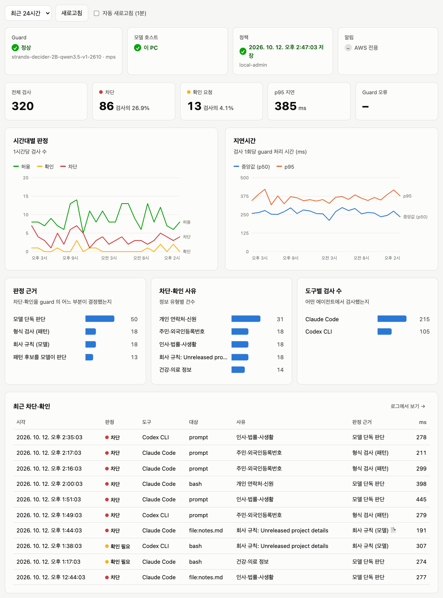
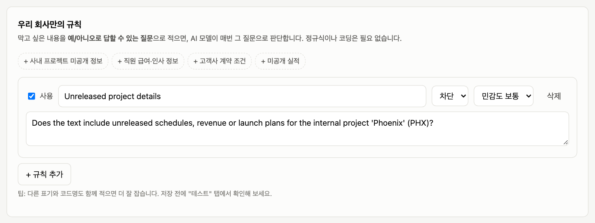
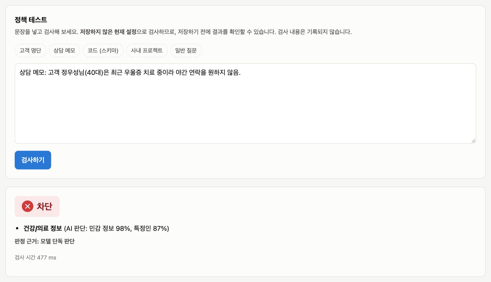
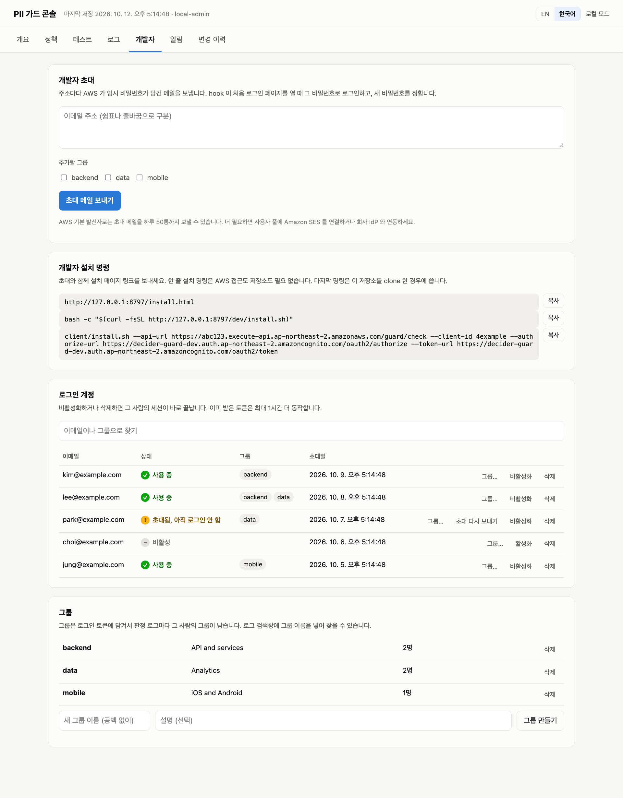
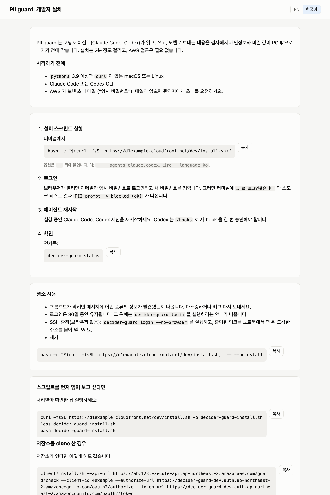

# strands-decider-guard

[](https://github.com/ltrain81/strands-decider-guard/actions/workflows/ci.yml)

**고객 PII와 비밀 값이 모델에 닿기 전에 막습니다.** 작고 빠른 판단 모델
[strands-decider](https://github.com/strands-labs/strands-decider)를 **Claude Code**, **Codex CLI** 앞단에 둡니다.
원하면 **LiteLLM** 프록시 안에도 둘 수 있습니다. Kiro CLI 는 선택 사항이며 도구 호출만 막을 수 있습니다.

- 프롬프트, 파일 읽기, 편집, 셸 명령을 수백 ms 안에 검사합니다.
- 민감하면 차단하거나 사용자에게 확인을 받습니다.
- 무엇이 민감한지는 관리자가 웹 콘솔에서 정합니다. 대부분의 규칙은 문장으로 쓴 질문이라 정규식을 몰라도 됩니다.

[English README](README.md)

```text
> 고객 주민등록번호 900101-1234567 로 가입 이력 조회하는 SQL 짜줘

UserPromptSubmit operation blocked by hook:
[PII guard] 민감 정보가 감지되어 차단했습니다 (프롬프트).
  - [prompt] 주민등록번호 패턴 감지 (900********567)
  마스킹하거나 해당 데이터를 제외하고 다시 시도하세요.
```

## 목차

- [동작 방식](#동작-방식)
- [경로 고르기](#경로-고르기)
- [빠른 시작: 로컬 (AWS 없이)](#빠른-시작-로컬-aws-없이)
- [빠른 시작: 팀용 AWS 배포](#빠른-시작-팀용-aws-배포)
  - [관리자](#관리자-한-번-aws-접근-필요)
  - [개발자](#개발자-각-pc)
- [에이전트별 검사 범위](#에이전트별-검사-범위)
- [정책 관리](#정책-관리)
- [운영과 비용](#운영과-비용)
- [정확도와 지연시간](#정확도와-지연시간)
- [한계](#한계)
- [문제 해결](#문제-해결)
- [저장소 구조](#저장소-구조)
- [개발](#개발)

더 보기:
- [설정 레퍼런스 (영문)](docs/CONFIGURATION.md)
- [정책 콘솔 가이드](docs/ADMIN.ko.md)
- [LiteLLM](docs/LITELLM.ko.md)
- [데모 영상 촬영](docs/DEMO_VIDEO.ko.md)

## 동작 방식


1. hook 이 프롬프트, 또는 도구 입력과 그 도구가 다루는 파일을 guard Lambda 로 보냅니다. 개발자 PC 는 **로그인** 방식(①′)을 씁니다. hook 이 ID 토큰을
   API Gateway 로 보내면 검증한 뒤 사용자와 그룹을 함께 넘깁니다. AWS 자격 증명은 필요 없습니다.
   ① **IAM** (`lambda:Invoke`)은 서비스용입니다: LiteLLM guardrail, 콘솔의 테스트 탭, 운영 명령.
   이미 모든 개발자에게 AWS 자격 증명을 주는 조직이라면 hook 에도 쓸 수 있습니다 ([IAM 방식](docs/SIGN_IN.ko.md#iam-방식-고급)).
   세 번째인 **로컬** 방식(`make local`)은 AWS 가 전혀 필요 없습니다. hook 이 같은 PC 의 strands-decider 로 엔진을 직접 실행합니다.
2. guard 는 정규식을 먼저 보고, GPU 호스트의 strands-decider 를 private IP 로 **한 번** 호출합니다.
3. S3 게이트웨이 엔드포인트로 읽은 현재 정책을 적용합니다 (30초 캐시).
4. 판정, 유형, 크기만 로그로 남기고 원문은 남기지 않습니다.
5. 통과한 것만 모델로 갑니다.

GPU 호스트는 공인 IP 없이 프라이빗 서브넷에 있습니다. 첫 부팅 때 패키지 설치·모델 다운로드와 SSM 통신만 NAT Gateway 를 거쳐 인터넷으로 나갑니다.
guard Lambda 는 인터넷 경로가 전혀 없는 격리 서브넷에서 실행됩니다.
`./deploy.sh --network public` 을 쓰면 호스트를 퍼블릭 서브넷에 둡니다 (NAT 비용 없음, 보안 그룹은 여전히 guard 만 허용).

관리자는:
- Ⓐ 콘솔을 엽니다 (CloudFront, Cognito 로그인).
- Ⓑ 정책 버전을 S3 에 저장하고, 켜 두었다면 보관된 원문을 봅니다.
- 판정 로그와 CloudWatch 로 통계와 알림을 봅니다 (EventBridge 가 5분마다 상태를 점검하고, 선택한 호스트 스케줄을 실행합니다).

다이어그램 원본은 [`docs/images/architecture.drawio`](docs/images/architecture.drawio) 입니다.
AWS 아이콘이 들어 있는 [draw.io](https://app.diagrams.net) 에서 열어 편집하면 됩니다.

**판정은 strands-decider 가 하고, 정규식은 돕기만 합니다.**
- 형식만으로 확실한 값은 정규식이 모델 호출 없이 막습니다. 주민등록번호, Luhn 검증을 통과한 카드번호, AWS 키, 개인 키입니다.
- 이메일·전화번호 같은 패턴은 *후보*일 뿐이고, 막을지는 모델이 정합니다.
- 나머지는 모두 모델이 판단합니다. 특정인의 건강·인사 사정 같은 문맥, 회사 규칙, 코드·스키마와 실제 데이터의 구분이 여기에 해당합니다.
- 콘솔의 **패턴 검사** 설정으로 정규식을 끄고 모델만으로 동작하게 할 수 있습니다. 벤치마크에서 모델만 쓰면 재현율 54%·오탐 1.7%, 패턴을 후보로 함께 쓰면 70%·3.4% 였습니다.
- 모든 판정에는 누가 결정했는지가 기록됩니다(형식 검사 / 패턴 후보를 모델이 판단 / 모델 단독 / 회사 규칙). 개요 탭에서 차트로 볼 수 있습니다.

검사 한 번에 모델 호출은 **한 번**입니다. 모델이 텍스트를 한 번 읽고 여러 질문에 답합니다.
- 어떤 종류의 민감 정보가 있는지
- 특정인에 관한 것인지
- 필드 이름이나 자리표시자가 아니라 실제 값인지
- 그리고 회사 전용 규칙 각각

주민등록번호나 유효한 카드번호처럼 확실한 패턴은 모델 호출 없이 정규식으로 바로 막습니다.
사유에는 항상 **마스킹된 값**만 나오고, 원문은 어디에도 로그로 남지 않습니다.

## 경로 고르기

| 하고 싶은 것 | 경로 | 필요한 것 | 시간 |
|---|---|---|---|
| 내 노트북에서 동작 확인 | [로컬](#빠른-시작-로컬-aws-없이) | Python 3.10+ (uv 권장). Apple 실리콘 Mac이나 NVIDIA GPU면 가장 빠름 | 약 10분 (첫 모델 다운로드 약 4GB) |
| 팀의 에이전트 보호 | [AWS](#빠른-시작-팀용-aws-배포) | 관리자: AWS 자격 증명, Node 18+, AWS CLI v2, GPU 쿼터. 개발자: python3 와 로그인 계정 | 약 25분, 개발자당 약 2분 |
| LiteLLM 프록시에서 강제 (사용자가 끌 수 없음) | [LiteLLM](docs/LITELLM.ko.md) | 위 둘 중 하나 | +10분 |
| 비개발자가 규칙 관리 | [정책 콘솔](docs/ADMIN.ko.md) | 위 둘 중 하나로 배포 (로컬은 로그인 없음) | — |

잘 모르겠으면 읽기 전용 점검부터 실행하세요. OS와 GPU, 도구, AWS 자격 증명, 설치된 에이전트를 보고
다음에 실행할 명령을 알려 줍니다.

```bash
git clone https://github.com/ltrain81/strands-decider-guard && cd strands-decider-guard
make doctor
```

## 빠른 시작: 로컬 (AWS 없이)

```bash
make local           # strands-decider 설치·실행 (127.0.0.1:8000) + hook 설치 (로컬 모드)
make demo            # Claude Code 로 다섯 장면 시연 (DEMO_LANG=ko 면 한국어)
make local-console   # 정책 콘솔 http://127.0.0.1:8770, 로그인 없음
```

- `make local` 은 에이전트 설정을 바꿉니다: `~/.claude/settings.json`, `~/.codex/hooks.json`.
  - 기존 hook 은 그대로 두고, 바꾼 파일은 `*.bak-decider-guard` 로 백업합니다. 되돌리려면 `make uninstall`.
- **Kiro CLI 는 선택 사항입니다** (`AGENTS=claude,codex,kiro`). PII 가 든 파일 읽기 같은 도구 호출은 막지만,
  사용자가 입력하거나 붙여 넣은 프롬프트는 막지 못합니다.
- 실행 중인 에이전트 세션은 다시 시작하세요. **Codex** 는 `/hooks` 에서 새 hook 을 한 번 승인해야 동작합니다.
- 디바이스는 자동으로 고릅니다. Apple 실리콘은 `mps`, NVIDIA GPU는 `cuda`, 그 외는 `cpu` 입니다.
  CPU 도 동작하지만 검사 한 번에 몇 초 걸립니다.

`demo/ko` 에서 직접 해 보세요 (모두 가짜 데이터):

```bash
cd demo/ko && claude
> customers.csv 읽고 고객 수 알려줘          # 거부: 주민번호, 이메일, 휴대폰
> support_ticket.txt 요약해줘               # 거부: 정규식에 안 걸리는 특정인의 건강 정보
> architecture.md 한 줄 요약                # 통과: "고객 연락처" 를 언급하지만 실제 값은 없음
```

## 빠른 시작: 팀용 AWS 배포

역할은 둘입니다. **관리자**가 한 번 배포하고 접근을 관리하며, 각 **개발자**는 자기 PC 에 hook 을 설치합니다.
개발자에게는 AWS 접근이 필요 없습니다.

### 관리자 (한 번, AWS 접근 필요)

1. 점검한 뒤 배포합니다:
   ```bash
   git clone https://github.com/ltrain81/strands-decider-guard && cd strands-decider-guard
   make preflight REGION=ap-northeast-2                          # 읽기 전용: 도구, 자격 증명, GPU 쿼터, IAM 역할, Elastic IP
   make deploy    REGION=ap-northeast-2 ADMIN_EMAIL=<내 메일>     # 스택 약 6분 + 첫 모델 로딩 약 10분
   ```
   - 배포가 만드는 것: strands-decider 가 도는 GPU 호스트(기본 `g6.xlarge`), 같은 VPC 의 guard Lambda,
     정책과 (선택) 원문을 저장하는 버전 관리 S3 버킷, 정책 콘솔(CloudFront, Cognito, HTTP API), 개발자 로그인 API.
   - GPU 호스트는 NAT Gateway 뒤 프라이빗 서브넷에 있고, NAT 에는 빈 Elastic IP 가 하나 필요합니다. preflight 가 없다고 하면
     쿼터 증설을 요청하거나 `DEPLOY_ARGS="--network public"` 으로 배포하세요 (퍼블릭 서브넷, NAT 없음).
   - 마지막에 스모크 테스트를 하고 콘솔 주소를 출력합니다. Cognito 가 임시 비밀번호를 메일로 보냅니다.
     콘솔 관리자 추가는 `make add-admin ADMIN_EMAIL=…`.
2. 콘솔 **개발자** 탭에서 개발자를 초대합니다 (그룹 지정 가능). 메일에 설치 페이지(`<콘솔 주소>/install.html`) 링크가 있고,
   그 페이지의 한 줄 명령으로 설치하므로 개발자는 AWS 접근도, 이 저장소도 필요 없습니다.
   콘솔 없이 배포했다면(`--no-console`) `make add-dev DEV_EMAIL=…` 로 계정을 만들고 `outputs.json` 의 값으로 설치 명령을 보내세요.
   초대 대신 회사 IdP 를 쓰려면 [docs/SIGN_IN.ko.md](docs/SIGN_IN.ko.md) 를 보세요.
3. 판정 로그마다 로그인한 사람과 그룹이 남습니다. 세션은 30일이고, 그 뒤에는 `decider-guard login`.
4. 운영:
   - `make console` 로 정책 콘솔을 엽니다: 정책, 테스트, 로그(사용자 포함), 알림. [콘솔 가이드](docs/ADMIN.ko.md) 참고.
   - `make status`, `make stop` / `make start` (GPU 호스트가 주요 비용입니다. [운영과 비용](#운영과-비용) 참고).
   - 개발자 탭: 초대, 재발송, 비활성화, 삭제와 그룹 관리 ([콘솔 가이드](docs/ADMIN.ko.md#개발자-탭)). 판정 로그마다 사람과 그룹이 남습니다.
5. 관리자 PC 도 보호하세요: `make add-dev DEV_EMAIL=<내 메일>` 후 `make install` (로그인합니다).

### 개발자 (각 PC)

**초대 메일을 받았다면** 메일의 설치 페이지(`<콘솔 주소>/install.html`)를 열고 한 줄 명령을 실행하세요:
`bash -c "$(curl -fsSL <콘솔 주소>/dev/install.sh)"`. hook 을 내려받고 로그인 페이지를 연 뒤 아래와 같은 과정을 진행합니다.

저장소를 clone 해서 설치하려면:

필요한 것: git, python3, Claude Code 또는 Codex, 관리자에게 받은 `outputs.json`, 임시 비밀번호가 담긴 메일.
저장소를 clone 할 수 없으면 관리자가 압축 파일로 전달해도 됩니다. 설치에는 `client/` 와 `guard/guard_core.py` 만 쓰입니다.

```bash
git clone https://github.com/ltrain81/strands-decider-guard && cd strands-decider-guard
cp ~/Downloads/outputs.json .                         # 관리자에게 받은 파일
client/install.sh --outputs outputs.json --auth jwt   # 브라우저가 열림: 로그인, 첫 로그인 때 새 비밀번호 설정
```

1. 설치 스크립트가 로그인하고, `~/.claude/settings.json` 과 `~/.codex/hooks.json` 에 hook 을 추가한 뒤
   (다른 hook 은 유지, 각 파일은 `*.bak-decider-guard` 로 백업) 스모크 테스트를 합니다. `PII prompt -> blocked (ok)` 가 나오면 정상입니다.
2. 실행 중인 Claude Code / Codex 세션을 재시작합니다. **Codex** 는 `/hooks` 로 한 번 승인해야 새 hook 이 동작합니다.
3. 상태 확인은 언제든 `decider-guard status`. `~/.decider-guard/bin/` 에 있고, `~/.local/bin` 이 있으면 거기에도 링크됩니다.
4. 30일이 지나거나 관리자가 접근을 회수하면 프롬프트가 "로그인하세요: decider-guard login" 으로 막힙니다. 그 명령을 실행하세요.
   SSH 환경에서는 `decider-guard login --no-browser` 로 하고, 브라우저가 도착한 주소를 붙여 넣습니다.
5. 제거는 `client/install.sh --uninstall`.

옵션:
- `--agents claude,codex,kiro`: Kiro 추가 (선택).
- `--language ko`: 메시지를 한국어로.
- `--claude-bedrock --bedrock-region us-west-2`: Claude Code 를 Amazon Bedrock 으로 연결.
- 고급: 이미 모든 개발자에게 AWS 자격 증명(IAM Identity Center)을 주는 조직은 로그인 대신 `--auth iam --profile <프로필>` 을
  쓸 수 있습니다. 장단점은 [IAM 방식](docs/SIGN_IN.ko.md#iam-방식-고급)을 보세요.

## 에이전트별 검사 범위

| | Claude Code | Codex CLI | LiteLLM 프록시 | Kiro CLI (선택) |
|---|---|---|---|---|
| 프롬프트 | **차단** (모델에 보이지 않음) | **차단** | **차단** (HTTP 400) | 차단 불가. 모델에 그 값을 쓰지 말라고 경고 |
| 파일 읽기 | Read 전에 내용 검사, **거부** | 셸 경유: `cat/head/grep 파일` 의 대상 파일 검사 | 모델에 가는 모든 tool result | read_file **거부** |
| 쓰기 / 수정 | Write, Edit, MultiEdit, NotebookEdit | apply_patch (추가된 줄) | — | fs_write, str_replace |
| 셸 | 명령 + 읽는 파일, **출력도 가림** | 명령 + 읽는 파일 | — | 명령 + 읽는 파일 |
| MCP / 웹 | 도구 입력 | 도구 입력 | — | 도구 입력 |
| "확인" 판정 | 확인창 | 차단 | 차단 (설정 가능) | 차단 |

## 정책 관리

콘솔은 일곱 개의 탭으로 되어 있습니다.
- **정책:**
  - 민감도 (관대 / 보통 / 엄격)
  - 정보 유형별 (주민번호, 신분증, 카드·계좌, 연락처, 건강정보, 비밀번호) 차단 / 확인 / 허용
  - **예/아니오 질문으로 쓰는 회사 전용 규칙.** 예: "사내 프로젝트 'Phoenix(피닉스)'의 미공개 일정이 있나요?"
  - 예외 목록 (회사 이메일 도메인, 테스트용 이름), 차단 안내 문구
- **테스트:** 저장 전 설정으로 문장을 검사합니다.
- **개요:**
  - guard, GPU 호스트, 알림의 상태
  - 검사 수, 차단율, p95 지연, 오류
  - 시간대별 판정·지연 차트
- **로그:** 검색할 수 있는 판정 로그(CSV 내보내기, 로그인한 사람과 그룹 포함)와 누가 무엇을 바꿨는지 보여 주는 관리자 활동 기록.
  *원문 보관*을 켜지 않으면 원문은 저장하지 않습니다.
- **개발자:** 이메일로 초대하고, 초대 재발송·비활성화·삭제와 그룹을 관리합니다. 개발자에게 보낼 공개 설치 페이지
  (`<콘솔 주소>/install.html`) 링크도 여기 있습니다 (AWS, 로그인 방식).
- **알림:** 이메일 수신자와 "guard 다운", 오류, 차단 급증, 검사 지연 경보 (AWS)
- **변경 이력:** 저장한 버전마다 기록이 남고, 지금 정책과 비교하고, 되돌릴 수 있습니다.

저장하면 30초 안에 모든 hook 과 LiteLLM guardrail 에 적용되며, 재배포는 필요 없습니다.

| 개요 | 회사 규칙 | 테스트 |
|---|---|---|
|  |  |  |

| 개발자 (초대, 로그인 계정, 그룹) | 개발자 설치 페이지 |
|---|---|
|  |  |

다른 화면은 [콘솔 가이드](docs/ADMIN.ko.md)에 있습니다.
- 가이드: [docs/ADMIN.ko.md](docs/ADMIN.ko.md)
- 로컬: `make local-console`
- AWS: `make console`. 로그인 추가는 `make add-admin ADMIN_EMAIL=…`

콘솔과 차단 메시지는 영어와 한국어를 지원합니다. 기본은 브라우저와 시스템 언어를 따르고,
hook 은 `--language en|ko`, 콘솔은 화면의 언어 전환 버튼으로 바꿀 수 있습니다.

## 운영과 비용

```bash
make status | make health      # 인스턴스 상태, guard → 모델 상태
make stop   | make start       # 안 쓸 때 GPU 호스트 정지 (주요 비용)
./ctl.sh logs                  # SSM 으로 호스트 설치·서비스 로그
make destroy                   # 전체 삭제 (스택 이름을 입력해 확인)
```

| 항목 | 대략적인 비용 |
|---|---|
| GPU 호스트 `g6.xlarge` (NVIDIA L4), 온디맨드 24시간 | ap-northeast-2 월 약 $731 (us-east-1 약 $600) |
| … 평일 08–20시만 (`SCHEDULE="MON-FRI 08:00-20:00"`) | 월 약 $267 |
| … Spot (`DEPLOY_ARGS=--spot`) + 평일 08–20시 | 월 약 $131 |
| EBS gp3 100GB | 월 약 $9 (위 금액에 포함), 호스트를 정지해도 과금 |
| NAT Gateway (기본 `--network nat`) | 월 약 $43, 24시간 과금. `--network public` 이면 없음 |
| Lambda, API Gateway, CloudFront, Cognito, S3, CloudWatch | 팀 규모에서는 거의 0 |

- 운영 시간 외, Spot 중단 중, `make stop` 상태에서는 guard 가 **정규식만으로 검사하며 계속 동작**합니다.
  강한 패턴은 막고, 이메일·전화번호는 "확인"으로 처리하며, 사유에 모델을 쓸 수 없었다고 표시합니다.
- 더 싼 하드웨어도 측정했지만 대화형 hook 에는 맞지 않았습니다([bench/COMPARISON.md](bench/COMPARISON.md#gpu-host-options)).
  - T4(`g4dn.xlarge`)는 약 3배 느립니다.
  - 분할 GPU와 CPU 전용 인스턴스는 검사 1건에 약 7초가 걸립니다.
- 팀 규모별 비용표(Bedrock Guardrails 포함)는 비교 문서에 있습니다.

`fail_mode` 는 hook 이 guard Lambda 자체에 닿지 못할 때(네트워크, AWS 자격 증명 문제)만 적용됩니다. 기본값 `closed` 는 막고,
`open` 은 경고와 함께 통과시킵니다. [설정 레퍼런스](docs/CONFIGURATION.md)를 보세요.

## 정확도와 지연시간

측정 데이터는 약 1,850건입니다.
- 공개 PII 데이터셋: ai4privacy, Gretel 금융, NVIDIA Nemotron-PII, k-pii-bench
- 합성 세트: 한국어 PII, 인사·법률·사생활
- 개발자 텍스트

임계값은 절반으로 정했고, 아래는 **나머지 절반**의 결과입니다([bench/TUNING.md](bench/TUNING.md)).

| 민감도 | 재현율 (영어 / 한국어) | 정밀도 | 오탐률 | 개발 텍스트 오탐 |
|---|---|---|---|---|
| 관대 | 62.6% (52.6 / 81.5) | 98.8% | 1.4% | 0% |
| **보통** | **70.0% (62.1 / 84.8)** | 97.4% | 3.4% | 3.1% |
| 엄격 | 75.7% (67.3 / 91.3) | 96.6% | 4.7% | 6.2% |

- 이전 버전은 같은 샘플에서 보통 기준 재현율 52.5%였습니다. 좋아진 이유:
  - 질문을 다듬고 **인사·법률·사생활** 유형을 새로 넣었습니다(해당 사례의 69–86%를 잡음).
  - 정규식이 맞으면 모델이 동의하지 않아도 잡습니다.
  - 공개된 테스트 카드번호와 자리표시자 비밀번호는 더 이상 걸리지 않습니다.
- **Amazon Bedrock Guardrails 와 비교** (같은 검증용 샘플, [bench/COMPARISON.md](bench/COMPARISON.md)):
  - 영어 PII: Guardrails(식별자만)의 재현율이 74% 대 62%로 높지만, 오탐이 2–3배입니다(11.8% 대 4.9%, 개발 텍스트 9.4% 대 3.1%).
  - 한국어: decider 가 앞섭니다. 재현율 85% 대 72%, 오탐 0%.
  - 회사 규칙: decider 가 크게 앞섭니다. F1 94 대 66.
- **지연시간:**
  - Apple 실리콘 Mac: 모델 검사 약 0.2–0.3초
  - AWS hook → Lambda → GPU: 순차 기준 p50 0.24초
  - 정규식만으로 막히는 경우: 1ms 이하
- GPU 호스트 1대는 초당 약 3.5건을 처리합니다. 동시 요청이 늘면 빨라지지 않고 줄을 섭니다.
- 쓰기 전에 콘솔 테스트 탭에서 실제 업무 문장으로 확인하세요.
### 지표의 뜻

양성은 개인정보가 있어 막아야 하는 텍스트, 음성은 개인정보가 없어 통과시켜야 하는 텍스트입니다.

| 지표 | 뜻 | 계산 |
|---|---|---|
| **재현율** (Recall) | 막아야 할 텍스트 중 실제로 막은 비율 | 막은 양성 ÷ 전체 양성 |
| **정밀도** (Precision) | 막은 텍스트 중 진짜 개인정보였던 비율 | 막은 양성 ÷ 막은 전체 |
| **오탐률** (FPR) | 정상 텍스트 중 잘못 막은 비율 | 막은 음성 ÷ 전체 음성 |
| **F1** | 재현율과 정밀도를 함께 본 하나의 숫자 | 2 · P · R ÷ (P + R) |

재현율이 낮으면 개인정보가 새어 나가고, 오탐률이 높으면 개발자가 괜히 막힙니다. 민감도 설정이 이 둘의 균형점을 정합니다.
"개발 텍스트 오탐"은 코드·SQL·설정 파일·기술 질문만 따로 잰 오탐률로, 개발자가 체감하는 불편에 가장 가깝습니다.

## 한계

- **클라이언트 hook 은 강제 수단이 아닙니다.** 사용자가 지울 수 있습니다. 강제하려면:
  - Claude Code 관리형 설정 (`managed-settings.json` + `allowManagedHooksOnly`)으로 배포하세요.
  - [LiteLLM guardrail](docs/LITELLM.ko.md)을 모델 앞에 두세요.
  - 또는 서버 측 백스톱으로 Bedrock Guardrails 를 쓰세요:
    `ANTHROPIC_CUSTOM_HEADERS="X-Amzn-Bedrock-GuardrailIdentifier: <id>\nX-Amzn-Bedrock-GuardrailVersion: 1"`
- **hook 이 놓치는 부분:**
  - Kiro CLI 는 프롬프트를 막을 수 없습니다.
  - Codex 는 hook 실패와 타임아웃을 "허용"으로 처리합니다.
  - Claude Code 의 Grep 결과와 `@파일` 참조는 hook 이 보지 못합니다.
- **원문 보관은 기본으로 꺼져 있습니다.**
  - 콘솔의 *원문 보관* 설정을 켜면 관리자가 판정을 검토할 수 있도록 검사한 텍스트를 저장합니다. 차단·확인만 보관하거나 전부 보관할 수 있습니다.
  - 원문은 암호화된 S3 에 저장되고 30일 뒤 삭제되며(`-c evidenceDays=N`), 콘솔 관리자만 볼 수 있고, 열람할 때마다 기록이 남습니다.
  - 켜면 그 버킷이 바로 보호하려는 데이터를 담게 되므로, 개인정보 담당자와 상의해서 정하세요.
- 긴 입력은 1,500자 청크 최대 16개를 샘플링합니다. 정규식은 전체를 봅니다 (파일당 최대 256KB).
- decider 서버는 인증이 없어서 공인 IP 없이(기본 네트워크) 두고 guard Lambda 보안 그룹에서만 접근할 수 있게 막았습니다. 동시 요청 처리 특성은 upstream 에도 문서화되어 있지 않습니다.
- 모델은 영어 중심입니다. 한국어 텍스트와 한국어 규칙은 테스트에서 동작했지만, 다른 언어는 확인한 뒤 쓰세요.

## 문제 해결

| 증상 | 해결 |
|---|---|
| "PII guard 에 로그인하지 않았거나 세션이 만료되었습니다" | `decider-guard login` 을 실행하세요. 계속 반복되면 관리자가 계정을 비활성화했을 수 있습니다 |
| `login failed: … CERTIFICATE_VERIFY_FAILED` | 이 Python 에 CA 인증서가 없습니다. 설치 스크립트를 다시 실행하거나(macOS 키체인으로 대체) `SSL_CERT_FILE` 을 지정하세요. Homebrew: `brew postinstall ca-certificates` |
| `login failed: … Address already in use` | 8723 포트를 다른 프로그램(대개 다른 `decider-guard login`)이 쓰고 있습니다. 닫고 다시 시도하세요 |
| 배포가 "The maximum number of addresses has been reached" 로 실패 | NAT Gateway 용 Elastic IP 가 없습니다. 쿼터 증설을 요청하거나 `DEPLOY_ARGS="--network public"` |
| 모든 프롬프트가 "guard 에 연결하지 못해 차단" 으로 막힘 | hook 이 guard Lambda 에 닿지 못하는 상태입니다. 네트워크와 AWS 자격 증명(`aws sts get-caller-identity`)을 확인하고 `make health`. 그동안 통과시키려면 `~/.decider-guard/config.json` 의 `fail_mode` 를 `open` 으로 |
| 사유에 "모델에 연결할 수 없어 패턴으로만 검사" 가 나옴 | GPU 호스트가 꺼져 있거나(일정, Spot 중단, `make stop`) 이상이 있습니다. `make status`, `make start`. 로컬 모드는 `scripts/local-decider.sh start` |
| `make deploy`: GPU 쿼터가 0 | Service Quotas → EC2 → *Running On-Demand G and VT instances* 에서 4 vCPU 이상 요청. 또는 쿼터가 있는 `--instance-type` 사용 |
| `Cannot exceed quota for RolesPerAccount` | 계정이 IAM 역할 한도에 찼습니다. 스택은 역할 2개(콘솔 포함 3개), CDK bootstrap 은 최초 1회 5개를 만듭니다. 안 쓰는 역할 정리, 한도 증가 요청, 또는 `DEPLOY_ARGS=--no-console` |
| CloudFormation 오류 후 재시도 | `make deploy` 를 다시 실행하세요. `ROLLBACK_COMPLETE` 상태의 스택은 자동으로 다시 만듭니다 |
| Codex 가 hook 을 무시 | `codex` 실행 후 `/hooks` 에서 한 번 승인하거나, 시작 화면에서 "Trust all" |
| Kiro 에서 프롬프트가 모델에 그대로 감 | 정상입니다. Kiro CLI 는 프롬프트를 막을 수 없고, 도구 호출은 막힙니다 |
| 오탐이 많음 | 콘솔 테스트 탭에서 "관대"를 시험하거나, 예외 목록을 추가하거나, 시끄러운 유형을 "확인"으로 |
| hook 이 느림 | GPU 를 쓰세요 (AWS 또는 Apple 실리콘 Mac). 오래 쉬다 첫 호출이면 Lambda 와 모델 준비 시간이 추가됩니다 |
| 전부 지우고 싶음 | 각 PC 에서 `make uninstall`, 그다음 `make destroy` |

## 저장소 구조

```text
Makefile                    진입점 (make help)
deploy.sh ctl.sh destroy.sh AWS 배포 / 운영 / 삭제
scripts/                    doctor.sh, local-decider.sh, lib.sh (공용 함수)
guard/guard_core.py         판정 엔진: 정규식 + decider + 정책. Lambda·콘솔·로컬 모드가 같은 코드를 씀
guard/lambda_handler.py     guard Lambda 진입점 (S3 정책, 30초 캐시)
client/                     decider_guard.py (세 에이전트 공용 hook. IAM, 로그인, 로컬), install.sh, configure_agents.py,
                            bootstrap.sh (설치 페이지의 한 줄 명령)
admin/                      정책 콘솔: web/index.html, web/install.html (개발자 설치 페이지),
                            api/handler.py, api/users.py (개발자와 그룹), dev_server.py (로컬, 로그인 없음)
litellm/                    LiteLLM 프록시 guardrail + 예시 설정
cdk/                        CDK 앱 (TypeScript): VPC, GPU 호스트, Lambda, S3, CloudFront, Cognito, API
demo/                       가짜 데이터 (en/, ko/), run_demo.sh, watch_audit.sh
tests/                      test_offline.py, test_signin.py, test_users.py (CI); test_with_model.py, eval_accuracy.py, 샘플
docs/                       설정, 콘솔, LiteLLM, 데모 촬영 (영문 + .ko.md)
```

## 개발

```bash
make test         # 오프라인 테스트 28개 (가짜 모델) + 셸 문법. CI 는 여기에 tsc, cdk synth 를 더 실행
make test-model   # 실행 중인 decider 로 정책 기능 테스트 (먼저 make local)
make eval         # 합성 샘플 정확도
```

판정 엔진은 `guard/guard_core.py` 이고 표준 라이브러리만 씁니다. Lambda, 콘솔 API, 로컬 hook 모드, LiteLLM guardrail 이
모두 이 파일을 가져다 쓰므로, 한 번 고치면 모든 곳에 적용됩니다. 사용자에게 보이는 문구는 `TEXT` / `MSG` / `I18N` 표에
영어와 한국어로 들어 있습니다. 언어를 추가하려면 각 표에 열을 하나씩 더하면 됩니다.

strands-decider 는 특정 커밋에 고정되어 있습니다 (`cdk/cdk.json` 의 `deciderRef`). AWS 호스트와 `make local` 이 같은 버전을 씁니다.
