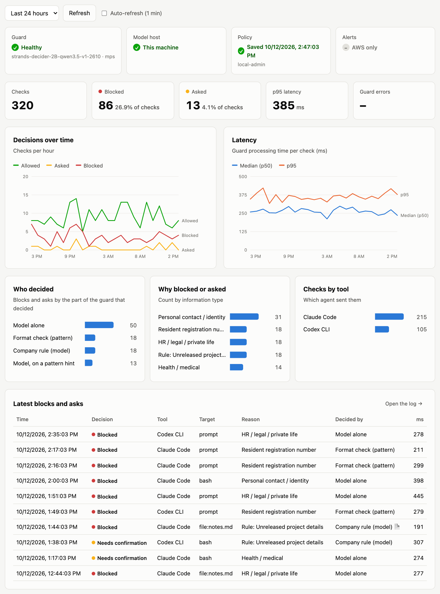
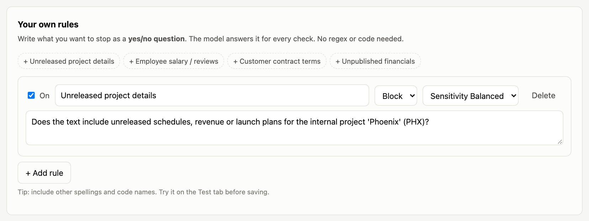
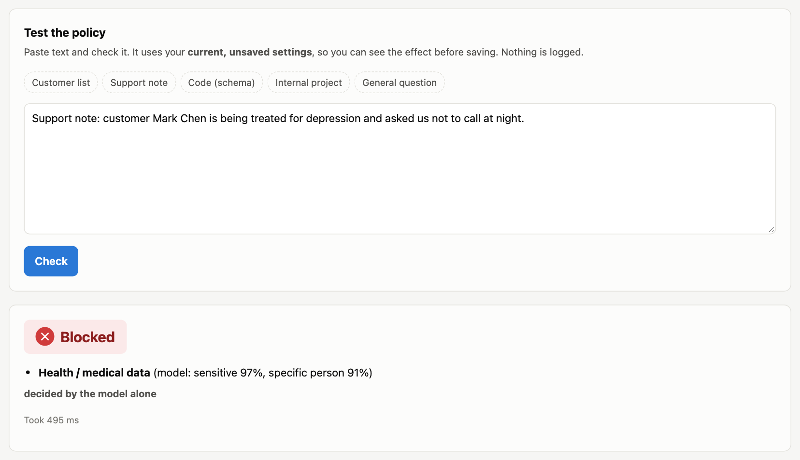
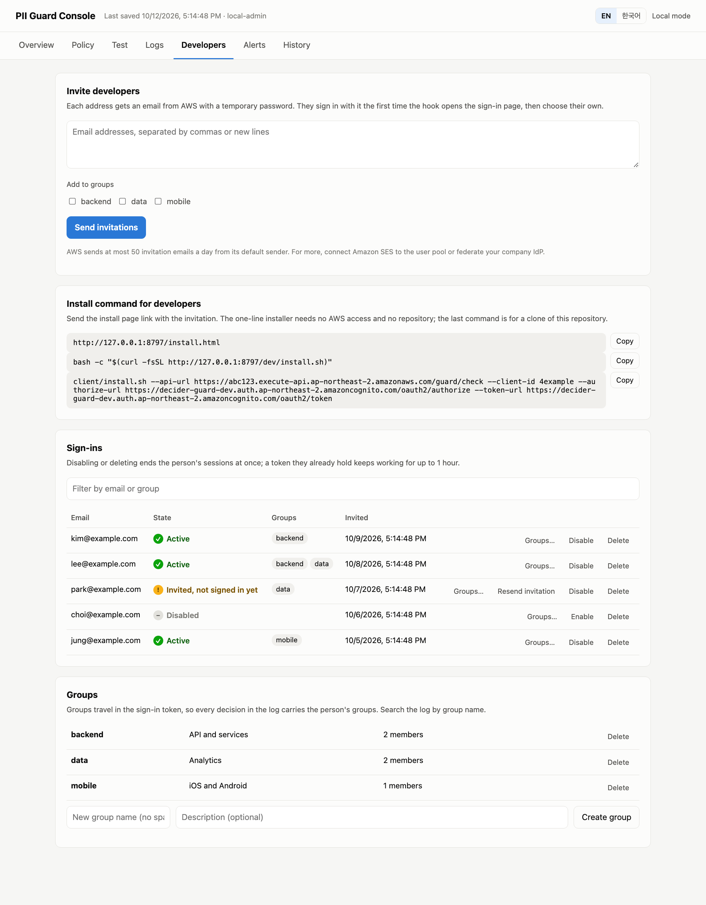
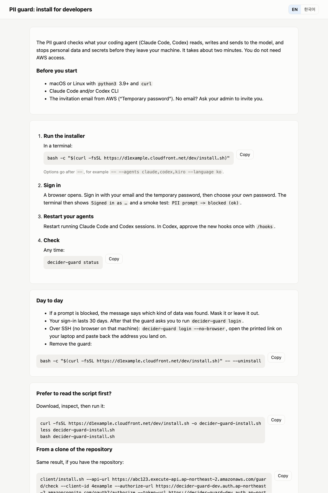

# strands-decider-guard

[](https://github.com/ltrain81/strands-decider-guard/actions/workflows/ci.yml)

**Stop customer PII and secrets before they reach the model.** This puts a small, fast decision model,
[strands-decider](https://github.com/strands-labs/strands-decider), in front of **Claude Code** and
**Codex CLI**, and optionally in your **LiteLLM** proxy. Kiro CLI is opt-in and covers tool calls only. Prompts, file reads, edits and shell commands are
checked in a few hundred milliseconds. Sensitive ones are blocked, or the user is asked to confirm. Admins manage
what counts as sensitive in a web console. Most rules are plain-language questions, so admins don't need to write regex.

[한국어 README](README.ko.md)

```text
> Write SQL to look up the customer with resident number 900101-1234567

UserPromptSubmit operation blocked by hook:
[PII guard] Sensitive data detected; blocked (prompt).
  - [prompt] Resident registration number pattern found (900********567)
  Mask it or leave that data out and try again.
```

## Contents

- [How it works](#how-it-works)
- [Choose your path](#choose-your-path)
- [Quick start: local, no AWS](#quick-start-local-no-aws)
- [Quick start: AWS for a team](#quick-start-aws-for-a-team)
  - [Admin](#admin-once-with-aws-access)
  - [Developer](#developer-each-machine)
- [What is checked in each agent](#what-is-checked-in-each-agent)
- [Managing the policy](#managing-the-policy)
- [Operations and cost](#operations-and-cost)
- [Accuracy and latency](#accuracy-and-latency)
- [Limitations](#limitations)
- [Troubleshooting](#troubleshooting)
- [Repository layout](#repository-layout)
- [Development](#development)

More detail: [Configuration reference](docs/CONFIGURATION.md) · [Policy console guide](docs/ADMIN.md) ·
[LiteLLM](docs/LITELLM.md) · [Recording a demo](docs/DEMO_VIDEO.md)

## How it works


1. The hook sends the prompt, or the tool input and the file it touches, to the guard Lambda. Developer machines **sign in** (①′): the hook sends an ID token to
   API Gateway, which checks it and passes the user and groups on. No AWS credentials are needed.
   ① **IAM** (`lambda:Invoke`) is for services: the LiteLLM guardrail, the console's test tab and the operations commands.
   Teams that already give every developer AWS credentials can use it for hooks too ([IAM mode](docs/SIGN_IN.md#iam-mode-advanced)).
   The third mode, **local** (`make local`), needs no AWS at all: the hook runs the engine itself against strands-decider on the same machine.
2. The guard runs the regexes, then makes **one** call to strands-decider on the GPU host over a private IP.
3. It applies the current policy, read from S3 through a gateway endpoint and cached for 30 s.
4. It logs only the decision, types and sizes, never the text.
5. Only what passed reaches the model.

The GPU host sits in a private subnet with no public IP. It reaches the internet only through a NAT Gateway, to install packages and
download the model on first boot and to talk to SSM. The guard Lambda runs in isolated subnets with no internet route at all.
`./deploy.sh --network public` puts the host in a public subnet instead (no NAT cost; its security group still accepts only the guard).

Admins:
- Ⓐ open the console (CloudFront, Cognito sign-in),
- Ⓑ save policy versions to S3 and, if enabled, view kept original text,
- see stats and alerts from the decision log and CloudWatch (EventBridge runs a health check every 5 minutes and the optional host schedule).

The diagram source is [`docs/images/architecture.drawio`](docs/images/architecture.drawio); open it in
[draw.io](https://app.diagrams.net), which includes the AWS icons.

**strands-decider makes the decisions; regexes only help.**
- A few values are certain from their format alone: resident registration numbers, Luhn-valid card numbers, AWS keys and private keys.
  Regexes block those without a model call.
- Emails, phone numbers and similar patterns are *hints*: the model decides whether they matter.
- Everything else is the model's call alone: context such as a named person's health or HR situation, company rules, and telling code
  or schemas apart from real data.
- The console's **Pattern checks** setting can switch regexes off to show the model alone. On the benchmark that gave 54 % recall and 1.7 %
  false positives; with patterns as hints it gave 70 % / 3.4 %.
- Every decision records who made it (format check, model on a pattern hint, model alone, company rule), and the Overview tab charts it.

Each check makes **one** model call. The model reads the text once and answers several questions about it:
which kind of sensitive data appears, whether it is about a specific person, whether it holds real values
(not field names or placeholders), plus each of your custom rules. Clear-cut patterns, such as a resident
registration number or a valid card number, are blocked by regex without calling the model.
Reasons always show **masked** values, and nothing logs the original text.

## Choose your path

| You want to… | Path | Needs | Time |
|---|---|---|---|
| See it work on your laptop | [Local](#quick-start-local-no-aws) | Python 3.10+ (uv recommended); a Mac with Apple silicon or an NVIDIA GPU is fastest | ~10 min (first model download ~4 GB) |
| Protect a team's agents | [AWS](#quick-start-aws-for-a-team) | admin: AWS credentials, Node 18+, AWS CLI v2, GPU quota. Developers: python3 and a sign-in | ~25 min, then ~2 min per developer |
| Enforce it in a LiteLLM proxy (cannot be bypassed by the user) | [LiteLLM](docs/LITELLM.md) | either of the above | +10 min |
| Let non-developers manage the rules | [Policy console](docs/ADMIN.md) | deployed with either path (local: no login) | — |

Not sure? Run the read-only check. It inspects your OS and GPU, tools, AWS credentials and the agents you
have installed, then prints the recommended next command:

```bash
git clone https://github.com/ltrain81/strands-decider-guard && cd strands-decider-guard
make doctor
```

## Quick start: local, no AWS

```bash
make local           # installs + starts strands-decider on 127.0.0.1:8000, installs the hooks (local mode)
make demo            # five scripted scenes with Claude Code (DEMO_LANG=ko for Korean)
make local-console   # policy console at http://127.0.0.1:8770, no login
```

- `make local` changes your agent configs: `~/.claude/settings.json` and `~/.codex/hooks.json`.
  Existing hooks are kept, and each changed file is backed up as `*.bak-decider-guard`. Undo with `make uninstall`.
- **Kiro CLI is opt-in** (`AGENTS=claude,codex,kiro`). Kiro can block tool calls, including reading a file with PII,
  but not a prompt someone types or pastes.
- Restart running agent sessions afterwards. **Codex** only runs new hooks after you approve them once with `/hooks`.
- The device is picked automatically (`mps` on Apple silicon, `cuda` with an NVIDIA GPU, else `cpu`).
  CPU works but takes seconds per check.

Try it yourself in `demo/en` (all data is synthetic):

```bash
cd demo/en && claude
> Read customers.csv and tell me how many customers there are     # denied: SSN, emails, phones
> Summarize support_ticket.txt                                     # denied: a named person's health data, no regex hit
> Summarize architecture.md                                        # allowed: mentions "contact fields", holds no values
```

## Quick start: AWS for a team

Two roles: an **admin** deploys once and manages access; each **developer** installs the hook on their own machine
and needs no AWS access.

### Admin (once, with AWS access)

1. Check, then deploy:
   ```bash
   git clone https://github.com/ltrain81/strands-decider-guard && cd strands-decider-guard
   make preflight REGION=ap-northeast-2                          # read-only: tools, credentials, GPU quota, IAM roles, Elastic IP
   make deploy    REGION=ap-northeast-2 ADMIN_EMAIL=<your email> # ~6 min stack + ~10 min first model load
   ```
   - The deploy creates a GPU host (default `g6.xlarge`) running strands-decider, a guard Lambda in the same VPC,
     versioned S3 buckets for the policy and (opt-in) original text, the policy console (CloudFront, Cognito, HTTP API)
     and the developer sign-in API.
   - The GPU host sits in a private subnet behind a NAT Gateway, which needs one free Elastic IP. If preflight reports none,
     request a quota increase or deploy with `DEPLOY_ARGS="--network public"` (host in a public subnet, no NAT).
   - It ends with a smoke test and prints the console URL. Cognito emails you a temporary password.
     Add more console admins with `make add-admin ADMIN_EMAIL=…`.
2. Invite developers in the console's **Developers** tab, optionally into groups. The email links to the install page
   (`<console URL>/install.html`) with a one-line installer, so developers need neither AWS access nor this repository.
   Without the console (`--no-console`), use `make add-dev DEV_EMAIL=…` and send the install command from `outputs.json`.
   With your company IdP instead of invitations, see [docs/SIGN_IN.md](docs/SIGN_IN.md).
3. Every decision is logged with the signed-in person and their groups. Sessions last 30 days, then `decider-guard login`.
4. Day to day:
   - `make console` opens the policy console: policy, test, logs (with the user), alerts. See the [console guide](docs/ADMIN.md).
   - `make status`, `make stop` / `make start` (the GPU host is the main cost; see [Operations and cost](#operations-and-cost)).
   - Developers tab: invite, resend, disable or delete sign-ins and manage groups ([console guide](docs/ADMIN.md#developers-tab)). Every decision is logged with the person and their groups.
5. Protect your own machine too: `make add-dev DEV_EMAIL=<your email>`, then `make install` (signs you in).

### Developer (each machine)

**Invited by email?** Open the install page linked in the email (`<console URL>/install.html`) and run its one command:
`bash -c "$(curl -fsSL <console URL>/dev/install.sh)"`. It downloads the hook, opens the sign-in page and runs the same steps as below.

From a clone of the repository instead:

You need git, python3, Claude Code and/or Codex, the `outputs.json` from your admin, and the email with your temporary password.
If you cannot clone the repository, your admin can send it as an archive: the installer only uses `client/` and `guard/guard_core.py`.

```bash
git clone https://github.com/ltrain81/strands-decider-guard && cd strands-decider-guard
cp ~/Downloads/outputs.json .                         # from your admin
client/install.sh --outputs outputs.json --auth jwt   # opens the browser: sign in, set a new password on first sign-in
```

1. The installer signs you in, adds the hooks to `~/.claude/settings.json` and `~/.codex/hooks.json` (other hooks are kept,
   each file is backed up as `*.bak-decider-guard`), then runs a smoke test. Expect `PII prompt -> blocked (ok)`.
2. Restart running Claude Code / Codex sessions. **Codex** runs new hooks only after you approve them once with `/hooks`.
3. Check any time with `decider-guard status`. It lives in `~/.decider-guard/bin/`, linked into `~/.local/bin` if that exists.
4. After 30 days, or if your admin revokes access, prompts are blocked with "Sign in with: decider-guard login". Run it.
   Over SSH, use `decider-guard login --no-browser` and paste the address the browser lands on.
5. Remove everything with `client/install.sh --uninstall`.

Options:
- `--agents claude,codex,kiro` adds Kiro (opt-in).
- `--language ko` switches the messages to Korean.
- `--claude-bedrock --bedrock-region us-west-2` also points Claude Code at Amazon Bedrock.
- Advanced: teams that already give every developer AWS credentials (IAM Identity Center) can use `--auth iam --profile <profile>`
  instead of signing in. See [IAM mode](docs/SIGN_IN.md#iam-mode-advanced) for the trade-offs.

## What is checked in each agent

| | Claude Code | Codex CLI | LiteLLM proxy | Kiro CLI (opt-in) |
|---|---|---|---|---|
| Prompt | **block** (prompt not shown to the model) | **block** | **block** (HTTP 400) | cannot block. The model is told not to use the values |
| File read | Read: content checked first, **deny** | via shell: `cat/head/grep FILE` reads checked | every tool result sent to the model | read_file: **deny** |
| Write / edit | Write, Edit, MultiEdit, NotebookEdit | apply_patch (added lines) | — | fs_write, str_replace |
| Shell | command + files it reads; **output is redacted** | command + files it reads | — | command + files it reads |
| MCP / web | tool input | tool input | — | tool input |
| "ask" verdict | confirmation dialog | blocks | blocks (configurable) | blocks |

## Managing the policy

The console has seven tabs:
- **Policy:** sensitivity (lenient / balanced / strict) and block / ask / allow for each information type
  (resident ID, government ID, card/bank, contact, health, credentials).
  Also **your own rules written as yes/no questions**, e.g. "Does the text include unreleased launch plans for project
  Phoenix (PHX)?", an allowlist (company email domains, fake test names) and the message shown when something is blocked.
- **Test:** check sample text against unsaved settings.
- **Overview:** health of the guard, the GPU host and alerts; checks, block rate, p95 latency and errors;
  charts of decisions and latency over time.
- **Logs:** a searchable decision log with CSV export (with the signed-in person and their groups), and an admin activity trail
  of who changed what. No text is stored unless you turn on *Keep original text*.
- **Developers:** invite people by email, resend, disable or delete their sign-ins, and manage groups. It also has the link to
  the public install page (`<console URL>/install.html`) to send developers (AWS, sign-in mode).
- **Alerts:** email recipients and alarms for "guard down", errors, block spikes and slow checks (AWS).
- **History:** every saved version, compare with the current one, and roll back.

Saved changes reach every hook and the LiteLLM guardrail within 30 seconds; nothing is redeployed.

| Overview | A custom rule | Test |
|---|---|---|
|  |  |  |

| Developers (invitations, sign-ins, groups) | Developer install page |
|---|---|
|  |  |

More screens in the [console guide](docs/ADMIN.md).
Guide: [docs/ADMIN.md](docs/ADMIN.md). Local: `make local-console`. AWS: `make console`, plus `make add-admin ADMIN_EMAIL=…` to add logins.

The console UI and block messages are available in English and Korean. They follow the browser and system
language by default; set them with `--language en|ko` (hooks) or the toggle (console).

## Operations and cost

```bash
make status | make health      # instance state, guard -> model health
make stop   | make start       # pause the GPU host when nobody needs it (the main cost)
./ctl.sh logs                  # host setup and service logs via SSM
make destroy                   # delete everything (asks you to type the stack name)
```

| Item | Approximate cost |
|---|---|
| GPU host `g6.xlarge` (NVIDIA L4), on-demand 24/7 | ~$731/month in ap-northeast-2 (~$600 in us-east-1) |
| … only weekdays 08–20 (`SCHEDULE="MON-FRI 08:00-20:00"`) | ~$267/month |
| … on Spot (`DEPLOY_ARGS=--spot`) + weekdays 08–20 | ~$131/month |
| EBS gp3 100 GB | ~$9/month, included above; also billed while the host is stopped |
| NAT Gateway (default `--network nat`) | ~$43/month, runs 24/7; `--network public` removes it |
| Lambda, API Gateway, CloudFront, Cognito, S3, CloudWatch | near zero at team scale |

- Outside the schedule, during a Spot interruption, or after `make stop`, the guard **falls back to regex-only checks** and keeps working.
  Strong patterns block, emails and phone numbers get "ask", and the reason says the model was unavailable.
- Cheaper hardware was measured and rejected for interactive use ([bench/COMPARISON.md](bench/COMPARISON.md#gpu-host-options)):
  - T4 (`g4dn.xlarge`) is about 3× slower.
  - Fractional-GPU and CPU-only instances take about 7 s per check.
- Team-size cost tables, including Bedrock Guardrails, are in the comparison.

`fail_mode` only matters when the hook cannot reach the guard Lambda itself (no network, no AWS credentials): `closed`, the
default, blocks; `open` allows with a warning. See [Configuration](docs/CONFIGURATION.md).

## Accuracy and latency

Measured on ~1,850 samples from public PII datasets (ai4privacy, Gretel finance, NVIDIA Nemotron-PII, k-pii-bench), synthetic Korean
and HR/legal sets, and developer-style text. The thresholds were tuned on one half; these are the **other half's** numbers
([bench/TUNING.md](bench/TUNING.md)):

| Sensitivity | Recall (en / ko) | Precision | False positives | on developer text |
|---|---|---|---|---|
| Lenient | 62.6 % (52.6 / 81.5) | 98.8 % | 1.4 % | 0 % |
| **Balanced** | **70.0 % (62.1 / 84.8)** | 97.4 % | 3.4 % | 3.1 % |
| Strict | 75.7 % (67.3 / 91.3) | 96.6 % | 4.7 % | 6.2 % |

- The previous release reached 52.5 % recall at balanced on the same samples. The gain came from:
  - sharper questions and a new **HR / legal / private life** type, which catches 69–86 % of those cases
  - regex hits that no longer need the model's agreement
  - published test card numbers and placeholder secrets no longer being flagged
- **Against Amazon Bedrock Guardrails**, on the same holdout samples ([bench/COMPARISON.md](bench/COMPARISON.md)):
  - English PII: Guardrails (identifiers only) has higher recall, 74 % vs 62 %, but 2–3× the false positives (11.8 % vs 4.9 %; 9.4 % vs 3.1 % on developer text).
  - Korean: the decider is ahead, 85 % vs 72 % recall with 0 % false positives.
  - Company rules: the decider is far ahead, F1 94 vs 66.
- **Latency:**
  - Mac (Apple silicon), model check: about 0.2–0.3 s.
  - AWS, hook → Lambda → GPU: 0.24 s p50 sequential.
  - Regex-only blocks: under 1 ms.
- One GPU host sustains about 3.5 checks/s. More concurrent requests queue up rather than run faster.
- Check your own data on the console's Test tab before relying on these numbers.
### What the numbers mean

Positives are texts that contain personal data and should be blocked; negatives are texts that don't and should pass.

| Metric | Meaning | Formula |
|---|---|---|
| **Recall** | share of the personal-data texts the guard blocked | blocked positives ÷ all positives |
| **Precision** | share of the blocked texts that really contained personal data | blocked positives ÷ everything blocked |
| **False-positive rate (FPR)** | share of the clean texts the guard blocked by mistake | blocked negatives ÷ all negatives |
| **F1** | one number balancing recall and precision | 2 · P · R ÷ (P + R) |

Low recall means personal data gets through; a high false-positive rate means developers get blocked for nothing. The sensitivity
presets move the balance between the two. "Developer text" is the false-positive rate measured on code, SQL, configs and technical
questions only, which is closest to what developers feel.

## Limitations

- **Client hooks are not enforcement.** A user can remove them. For enforcement:
  - Ship them via Claude Code managed settings (`managed-settings.json` + `allowManagedHooksOnly`).
  - Put the [LiteLLM guardrail](docs/LITELLM.md) in front of the models.
  - Or use Bedrock Guardrails as a server-side backstop:
    `ANTHROPIC_CUSTOM_HEADERS="X-Amzn-Bedrock-GuardrailIdentifier: <id>\nX-Amzn-Bedrock-GuardrailVersion: 1"`.
- **Gaps in the hooks:**
  - Kiro CLI cannot block prompts.
  - Codex treats hook failures and timeouts as "allow".
  - Claude Code's Grep results and `@file` mentions are not seen by the hooks.
- **Original text is off by default.** The console's *Keep original text* setting stores the checked text so admins can review
  decisions. It keeps blocked/asked checks only, or everything. The text is stored in an encrypted S3 bucket, deleted after 30 days
  (`-c evidenceDays=N`), readable only by console admins, and every view is recorded. Turning it on means that bucket holds the very
  data you are trying to protect, so decide with your privacy officer.
- Long inputs are sampled: up to 16 chunks of 1,500 characters. The regexes still scan the whole text (up to 256 KB per file).
- The decider server has no authentication. It has no public IP (default network) and only the guard Lambda's security group can reach it. Its behaviour
  under concurrent requests is not documented upstream.
- The model is English-first. Korean text and Korean rules worked in our tests; check other languages before relying on them.

## Troubleshooting

| Symptom | Fix |
|---|---|
| "Not signed in to the PII guard, or the session expired" | Run `decider-guard login`. If it keeps happening, your admin may have disabled your sign-in |
| `login failed: … CERTIFICATE_VERIFY_FAILED` | This Python has no CA certificates. Re-run the installer (the hook falls back to the macOS keychain), or set `SSL_CERT_FILE`. Homebrew: `brew postinstall ca-certificates` |
| `login failed: … Address already in use` | Port 8723 is taken, usually by another `decider-guard login`. Close it and retry |
| Deploy fails with "The maximum number of addresses has been reached" | No free Elastic IP for the NAT Gateway: request a quota increase, or `DEPLOY_ARGS="--network public"` |
| Every prompt is blocked with "Could not reach the guard" | The hook cannot reach the guard Lambda: check network and AWS credentials (`aws sts get-caller-identity`), then `make health`. To allow while it is down, set `fail_mode: open` in `~/.decider-guard/config.json` |
| Reasons say "model unavailable: checked with patterns only" | The GPU host is stopped (schedule, Spot interruption, `make stop`) or unhealthy: `make status`, `make start`. Local mode: `scripts/local-decider.sh start` |
| `make deploy`: GPU quota is 0 | Service Quotas → EC2 → *Running On-Demand G and VT instances*: request at least 4 vCPUs. Or use `--instance-type` with a type you have quota for |
| `Cannot exceed quota for RolesPerAccount` | Your account is at the IAM role limit. The stack adds 2 roles (3 with the console), and CDK bootstrap adds 5 once. Free some roles, request an increase, or use `DEPLOY_ARGS=--no-console` |
| `CREATE_FAILED … Invalid rule description` or other CloudFormation errors | Re-run `make deploy`. A stack in `ROLLBACK_COMPLETE` is recreated automatically |
| Codex ignores the hooks | Approve them once: start `codex` and run `/hooks`, or choose "Trust all" at startup |
| Kiro shows the prompt to the model anyway | Expected: Kiro CLI cannot block prompts. Tool calls are still blocked |
| Too many false positives | On the console's Test tab, try "Lenient", add allowlist entries, or set noisy types to "ask" |
| The hooks are too slow | Use a GPU (AWS or a Mac with Apple silicon). The first call after idle also pays Lambda and model warm-up |
| I want to remove everything | `make uninstall` on each machine, then `make destroy` |

## Repository layout

```text
Makefile                    entry points (make help)
deploy.sh ctl.sh destroy.sh AWS deploy / operate / delete
scripts/                    doctor.sh, local-decider.sh, lib.sh (shared helpers)
guard/guard_core.py         the engine: regex + decider + policy. Shared by the Lambda, console and local mode
guard/lambda_handler.py     guard Lambda entry point (policy from S3, 30 s cache)
client/                     decider_guard.py (one hook for all three agents; IAM, sign-in or local), install.sh, configure_agents.py,
                            bootstrap.sh (the install page's one-liner)
admin/                      policy console: web/index.html, web/install.html (developer install page),
                            api/handler.py, api/users.py (developers and groups), dev_server.py (local, no login)
litellm/                    LiteLLM proxy guardrail + example config
cdk/                        CDK app (TypeScript): VPC, GPU host, Lambdas, S3, CloudFront, Cognito, API
demo/                       synthetic data (en/, ko/), run_demo.sh, watch_audit.sh
tests/                      test_offline.py, test_signin.py, test_users.py (CI); test_with_model.py, eval_accuracy.py, samples
docs/                       configuration, console, LiteLLM, demo recording (English + .ko.md)
```

## Development

```bash
make test         # 28 offline tests (fake model) + shell syntax. CI runs this plus tsc and cdk synth
make test-model   # policy features against a running decider (make local first)
make eval         # accuracy on the synthetic samples
```

The engine is `guard/guard_core.py`, stdlib only. The Lambda, the console API, the local hook mode and the LiteLLM
guardrail all import it, so a change there applies everywhere. User-facing strings live in `TEXT` / `MSG` /
`I18N` tables (English and Korean). Add a language by adding a column to each.

strands-decider is pinned to a commit (`deciderRef` in `cdk/cdk.json`). Both the AWS host and `make local` use it.
